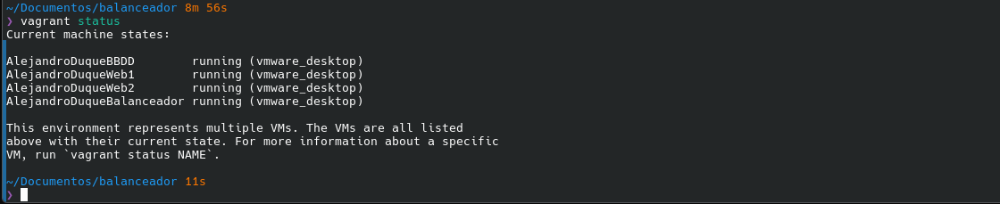
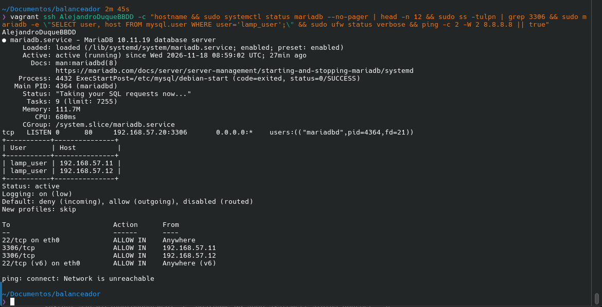
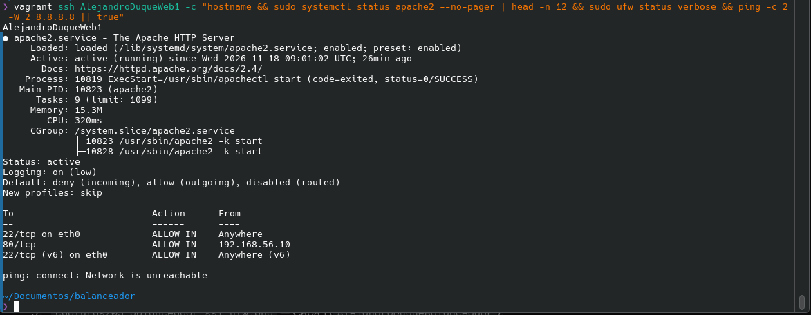
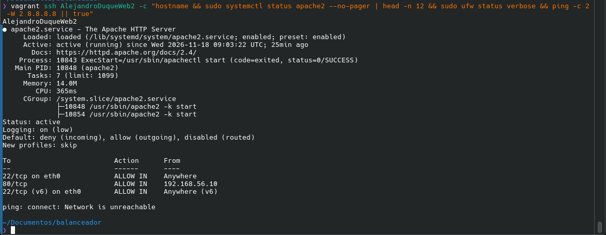
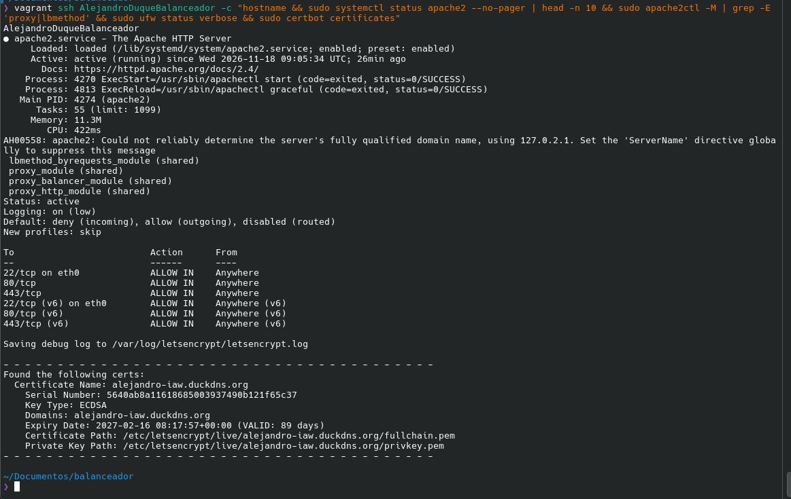
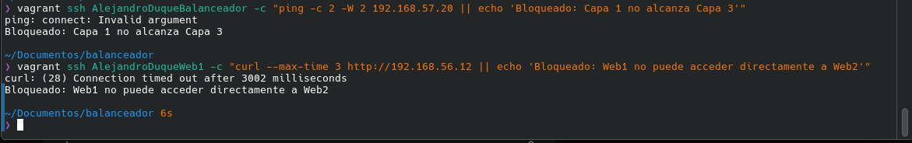
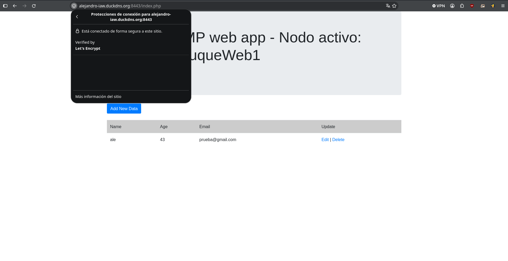
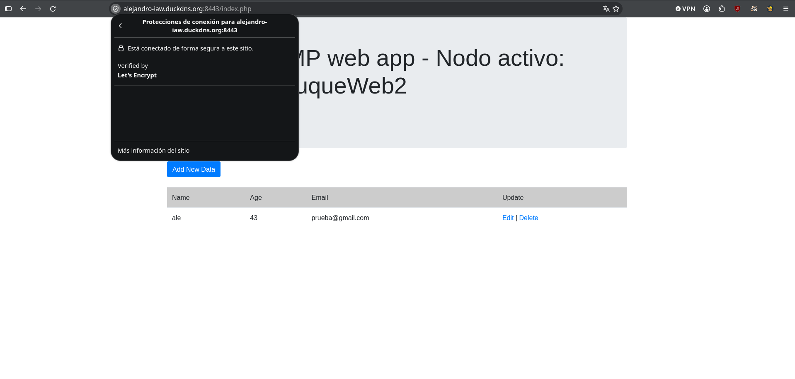
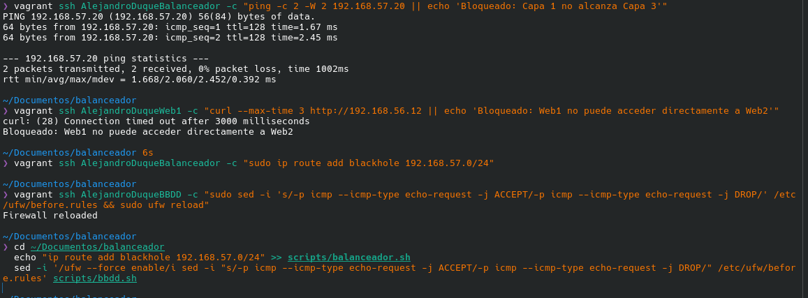

# Balanceador de Carga con Apache


**Autor:** Alejandro Duque  
**Módulo:** Implantación de Aplicaciones Web (ASIR 2)  
**Entorno de despliegue:** Vagrant + VMware Workstation (`vmware_desktop`) sobre CachyOS  

---

## Índice

1. [Introducción](#1-introducción)
2. [Arquitectura y diseño de red](#2-arquitectura-y-diseño-de-red)
3. [Estructura del proyecto y definición en Vagrant](#3-estructura-del-proyecto-y-definición-en-vagrant)
4. [Aprovisionamiento de la Capa 3: Base de Datos (`AlejandroDuqueBBDD`)](#4-aprovisionamiento-de-la-capa-3-base-de-datos-alejandroduquebbdd)
5. [Aprovisionamiento de la Capa 2: Servidores Web (`AlejandroDuqueWeb1` y `AlejandroDuqueWeb2`)](#5-aprovisionamiento-de-la-capa-2-servidores-web-alejandroduqueweb1-y-alejandroduqueweb2)
6. [Aprovisionamiento de la Capa 1: Balanceador de Carga (`AlejandroDuqueBalanceador`)](#6-aprovisionamiento-de-la-capa-1-balanceador-de-carga-alejandroduquebalanceador)
7. [Dominio dinámico y certificado SSL válido con Certbot y Let's Encrypt](#7-dominio-dinámico-y-certificado-ssl-válido-con-certbot-y-lets-encrypt)
8. [Listas de control de acceso (ACL) y grupos de seguridad](#8-listas-de-control-de-acceso-acl-y-grupos-de-seguridad)
9. [Comprobación del funcionamiento](#9-comprobación-del-funcionamiento)
10. [Screencast de demostración](#10-screencast-de-demostración)
11. [Incidencias encontradas y soluciones](#11-incidencias-encontradas-y-soluciones)
12. [Conclusiones](#12-conclusiones)
13. [Bibliografía](#13-bibliografía)

---

## 1. Introducción

El objetivo es diseñar, aprovisionar y asegurar una arquitectura web repartida en **tres niveles** utilizando cuatro máquinas virtuales **Debian 12 (`generic/debian12`)** (son las que soporta VMware) gestionadas mediante **Vagrant** sobre el proveedor **VMware Workstation (`vmware_desktop`)** en **CachyOS**.

Esta topología separa las funciones en capas independientes para mejorar tanto el rendimiento como la disponibilidad y la seguridad:

* **Proxy inverso y balanceador de carga (Capa 1):** Actúa como único punto de entrada desde el exterior. Intercepta las peticiones de los clientes, gestiona el cifrado **HTTPS** mediante un certificado oficial de **Let's Encrypt** y distribuye las solicitudes de forma equilibrada entre los servidores web internos sin exponer su infraestructura.
* **Servidores de aplicaciones web (Capa 2):** Dos nodos iguales con **Apache 2** y **PHP 8.2** que ejecutan la lógica de la aplicación web. Al contar con dos instancias activas en paralelo, si una sufre una sobrecarga o caída, el servicio sigue funcionando a través del segundo nodo.
* **Servidor de base de datos (Capa 3):** Un nodo dedicado con **MariaDB** situado en el nivel más profundo de la red, completamente aislado de Internet y accesible únicamente desde los dos servidores web de la capa intermedia.

---

## 2. Arquitectura y diseño de red

Para que ningún tráfico externo pueda saltar directamente hacia los servidores de aplicaciones o hacia la base de datos, se han definido **dos subredes privadas independientes** (`192.168.56.0/24` y `192.168.57.0/24`):

```text
                                [ HOST: CachyOS ]
                    https://alejandro-iaw.duckdns.org:8443
                                       |
                        Port Forwarding (80->8080, 443->8443)
                                       v
+------------------------------------------------------------------------------+
| CAPA 1 (Subred Pública): AlejandroDuqueBalanceador                           |
|   - Subred Frontend: 192.168.56.10                                           |
|   - Apache 2 (mod_proxy_balancer) + Certbot SSL + UFW (puertos 80 y 443)     |
+--------------------------------------+---------------------------------------+
                                       | HTTP (80) interno
                     +-----------------+-----------------+
                     v                                   v
+--------------------------------------+ +-------------------------------------+
| CAPA 2 (Privada): AlejandroDuqueWeb1 | | CAPA 2 (Privada): AlejandroDuqueWeb2|
|   - Subred Frontend: 192.168.56.11   | |   - Subred Frontend: 192.168.56.12  |
|   - Subred Backend:  192.168.57.11   | |   - Subred Backend:  192.168.57.12  |
|   - Apache 2 + PHP 8.2 + UFW (80)    | |   - Apache 2 + PHP 8.2 + UFW (80)   |
|   - [SIN SALIDA A INTERNET]          | |   - [SIN SALIDA A INTERNET]         |
+--------------------+-----------------+ +-----------------+-------------------+
                     |                                     |
                     +-----------------+-------------------+
                                       | SQL (TCP 3306)
                                       v
+------------------------------------------------------------------------------+
| CAPA 3 (Privada): AlejandroDuqueBBDD                                         |
|   - Subred Backend: 192.168.57.20                                            |
|   - MariaDB Server (bind 192.168.57.20) + UFW (3306 solo desde Web1 y Web2)  |
|   - [SIN SALIDA A INTERNET]                                                  |
+------------------------------------------------------------------------------+
```

### Resumen de instancias y direccionamiento

| Capa | Nombre de la máquina (`hostname`) | Subred Frontend (`192.168.56.0/24`) | Subred Backend (`192.168.57.0/24`) | Salida a Internet | Función principal |
| :--- | :--- | :--- | :--- | :--- | :--- |
| **Capa 1** | `AlejandroDuqueBalanceador` | `192.168.56.10` | *Sin interfaz* | **Sí** (NAT) | Proxy inverso, balanceo HTTP y terminación SSL |
| **Capa 2** | `AlejandroDuqueWeb1` | `192.168.56.11` | `192.168.57.11` | **No** (aislada) | Servidor web backend 1 (Apache 2 + PHP) |
| **Capa 2** | `AlejandroDuqueWeb2` | `192.168.56.12` | `192.168.57.12` | **No** (aislada) | Servidor web backend 2 (Apache 2 + PHP) |
| **Capa 3** | `AlejandroDuqueBBDD` | *Sin interfaz* | `192.168.57.20` | **No** (aislada) | Servidor de base de datos MariaDB |

---

## 3. Estructura del proyecto y definición en Vagrant

El repositorio sigue una estructura en la que cada capa cuenta con su propio script de aprovisionamiento automatizado en Bash:

```text
balanceador/
├── Vagrantfile
├── README.md
├── scripts/
│   ├── bbdd.sh
│   ├── web.sh
│   ├── balanceador.sh
│   └── ssl.sh
├── capturas/
│   └── *.png
└── screencast/
    └── balanceador.mp4
```

### Archivo `Vagrantfile`

En el `Vagrantfile` se definen las cuatro máquinas virtuales utilizando `generic/debian12` con `1024 MB` de memoria RAM por nodo. Solo `AlejandroDuqueBalanceador` dispone de redirección de puertos hacia el equipo anfitrión (`8080 -> 80` y `8443 -> 443`), actuando como equivalente a la instancia expuesta con IP elástica en un entorno de nube:

```ruby
Vagrant.configure("2") do |config|
  config.vm.box = "generic/debian12"

  # Capa 3: Servidor de Base de Datos (Subred 192.168.57.0/24)
  config.vm.define "AlejandroDuqueBBDD" do |bbdd|
    bbdd.vm.hostname = "AlejandroDuqueBBDD"
    bbdd.vm.network "private_network", ip: "192.168.57.20"
    bbdd.vm.provision "shell", path: "scripts/bbdd.sh"
  end

  # Capa 2: Servidor Web 1 (Subred 192.168.56.0/24 y 192.168.57.0/24)
  config.vm.define "AlejandroDuqueWeb1" do |web1|
    web1.vm.hostname = "AlejandroDuqueWeb1"
    web1.vm.network "private_network", ip: "192.168.56.11"
    web1.vm.network "private_network", ip: "192.168.57.11"
    web1.vm.provision "shell", path: "scripts/web.sh"
  end

  # Capa 2: Servidor Web 2 (Subred 192.168.56.0/24 y 192.168.57.0/24)
  config.vm.define "AlejandroDuqueWeb2" do |web2|
    web2.vm.hostname = "AlejandroDuqueWeb2"
    web2.vm.network "private_network", ip: "192.168.56.12"
    web2.vm.network "private_network", ip: "192.168.57.12"
    web2.vm.provision "shell", path: "scripts/web.sh"
  end

  # Capa 1: Balanceador de Carga Apache 2 (Subred 192.168.56.0/24 + Puertos Host)
  config.vm.define "AlejandroDuqueBalanceador" do |bal|
    bal.vm.hostname = "AlejandroDuqueBalanceador"
    bal.vm.network "private_network", ip: "192.168.56.10"
    bal.vm.network "forwarded_port", guest: 80, host: 8080
    bal.vm.network "forwarded_port", guest: 443, host: 8443

    bal.vm.provision "shell", path: "scripts/balanceador.sh"
    bal.vm.provision "letsencrypt", type: "shell", path: "scripts/ssl.sh",
      env: { "DUCKDNS_TOKEN" => ENV.fetch("DUCKDNS_TOKEN", "") }, run: "never"
  end

  config.vm.provider "vmware_desktop" do |v|
    v.gui = false
    v.memory = "1024"
    v.linked_clone = false
  end
end
```

Para respetar el orden de dependencias, el despliegue se lanza arrancando primero la base de datos, a continuación los dos servidores web y finalmente el balanceador:

```bash
vagrant up AlejandroDuqueBBDD AlejandroDuqueWeb1 AlejandroDuqueWeb2 AlejandroDuqueBalanceador
```



---

## 4. Aprovisionamiento de la Capa 3: Base de Datos (`AlejandroDuqueBBDD`)

El script `scripts/bbdd.sh` automatiza la instalación del servidor **MariaDB**:

1. **Vinculación estricta de red:** Modifica `bind-address` en `/etc/mysql/mariadb.conf.d/50-server.cnf` para que el motor SQL escuche solo en la interfaz privada de la subred backend (`192.168.57.20`), evitando exponer el puerto `3306` en otras interfaces.
2. **Despliegue de la base de datos y privilegios mínimos:** Importa la estructura de `lamp_db` y crea el usuario `lamp_user` restringido únicamente a las direcciones IP de los dos nodos web (`192.168.57.11` y `192.168.57.12`), dando exclusivamente los permisos necesarios para operar sobre los registros (`SELECT`, `INSERT`, `UPDATE` y `DELETE`).
3. **Cortafuegos y aislamiento total:** Configura `ufw` para denegar todo el tráfico entrante excepto el puerto `3306/tcp` procedente de la Capa 2 (y el puerto `22` en la interfaz de gestión de Vagrant), bloquea las peticiones ICMP (`echo-request`) y elimina la ruta por defecto (`ip route del default`) para desconectar la máquina de Internet.

### Código de `scripts/bbdd.sh`

```bash
#!/bin/bash
set -e
export DEBIAN_FRONTEND=noninteractive

apt-get update -y
apt-get install -y mariadb-server git ufw

# Escuchar únicamente en la interfaz de la subred de datos
sed -i "s/^bind-address.*/bind-address = 192.168.57.20/" /etc/mysql/mariadb.conf.d/50-server.cnf
systemctl restart mariadb

# Importar esquema de base de datos
rm -rf /tmp/app
git clone https://github.com/josejuansanchez/iaw-practica-lamp.git /tmp/app

mariadb -e "DROP DATABASE IF EXISTS lamp_db; CREATE DATABASE lamp_db;"
mariadb lamp_db < /tmp/app/db/database.sql

# Crear usuario con privilegios mínimos restringido a Web1 y Web2
for NODO_WEB in "192.168.57.11" "192.168.57.12"; do
    mariadb -e "
        DROP USER IF EXISTS 'lamp_user'@'${NODO_WEB}';
        CREATE USER 'lamp_user'@'${NODO_WEB}' IDENTIFIED BY 'lamp_password';
        GRANT SELECT, INSERT, UPDATE, DELETE ON lamp_db.* TO 'lamp_user'@'${NODO_WEB}';
    "
done
mariadb -e "FLUSH PRIVILEGES;"
rm -rf /tmp/app

# Cortafuegos de Capa 3: permite SSH de gestión y MySQL (3306) solo desde Capa 2
IF_NAT=$(ip -o -4 route show to default | awk '{print $5}' | head -n1)
ufw --force reset
ufw default deny incoming
ufw default allow outgoing
ufw allow in on "$IF_NAT" to any port 22 proto tcp
ufw allow from 192.168.57.11 to any port 3306 proto tcp
ufw allow from 192.168.57.12 to any port 3306 proto tcp
sed -i "s/-p icmp --icmp-type echo-request -j ACCEPT/-p icmp --icmp-type echo-request -j DROP/" /etc/ufw/before.rules
ufw --force enable

# Aislar completamente de Internet
ip route del default || true
```

En la siguiente captura se verifica que **MariaDB** está activo escuchando únicamente en `192.168.57.20:3306`, que `lamp_user` solo tiene acceso desde `.57.11` y `.57.12`, que `ufw` filtra el tráfico y que la máquina no tiene salida a Internet:



---

## 5. Aprovisionamiento de la Capa 2: Servidores Web (`AlejandroDuqueWeb1` y `AlejandroDuqueWeb2`)

Ambas máquinas de la segunda capa comparten el mismo script de aprovisionamiento (`scripts/web.sh`), garantizando una configuración igual en los dos nodos:

1. **Pila Apache 2 + PHP:** Instala el servidor web **Apache 2**, **PHP 8.2** y la extensión `php-mysql`.
2. **Conexión remota con Capa 3:** Clona el código fuente de la aplicación en `/var/www/html` y actualiza `/var/www/html/config.php` para que las consultas SQL se dirijan a la dirección privada `192.168.57.20`.
3. **Identificación dinámica del nodo:** Inserta el comando `$(hostname)` en el encabezado de `index.php` para que cada servidor muestre su propio nombre al responder una petición, permitiendo comprobar visualmente el reparto de carga.
4. **Seguridad y aislamiento:** Activa `ufw` aceptando conexiones HTTP (`80/tcp`) únicamente desde la IP del balanceador (`192.168.56.10`) y elimina la puerta de enlace predeterminada tras finalizar la instalación de paquetes.

### Código de `scripts/web.sh`

```bash
#!/bin/bash
set -e
export DEBIAN_FRONTEND=noninteractive

apt-get update -y
apt-get install -y apache2 php libapache2-mod-php php-mysql git ufw

# Desplegar aplicación web
rm -rf /tmp/app /var/www/html/*
git clone https://github.com/josejuansanchez/iaw-practica-lamp.git /tmp/app
cp -r /tmp/app/src/* /var/www/html/
rm -rf /tmp/app

# Configurar conexión con AlejandroBBDD (192.168.57.20)
sed -i "s/localhost/192.168.57.20/" /var/www/html/config.php
sed -i "s/database_name_here/lamp_db/" /var/www/html/config.php
sed -i "s/username_here/lamp_user/" /var/www/html/config.php
sed -i "s/password_here/lamp_password/" /var/www/html/config.php

# Mostrar qué nodo web procesa cada visita
sed -i "s/Simple LAMP web app/Simple LAMP web app - Nodo activo: $(hostname)/" /var/www/html/index.php

chown -R www-data:www-data /var/www/html
systemctl restart apache2

# Cortafuegos de Capa 2: permite SSH de gestión y HTTP (80) solo desde el balanceador
IF_NAT=$(ip -o -4 route show to default | awk '{print $5}' | head -n1)
ufw --force reset
ufw default deny incoming
ufw default allow outgoing
ufw allow in on "$IF_NAT" to any port 22 proto tcp
ufw allow from 192.168.56.10 to any port 80 proto tcp
ufw --force enable

# Aislar completamente de Internet
ip route del default || true
```

En las siguientes capturas se ve el servicio **Apache 2** en ejecución en los dos servidores web, las reglas del firewall restringidas a `192.168.56.10` y la ausencia de conectividad hacia Internet:





---

## 6. Aprovisionamiento de la Capa 1: Balanceador de Carga (`AlejandroDuqueBalanceador`)

El nodo frontal `AlejandroDuqueBalanceador` utiliza **Apache 2** configurado como **proxy inverso y balanceador de carga** mediante `scripts/balanceador.sh`:

1. **Activación de módulos de Apache:** Se habilitan `proxy`, `proxy_http`, `proxy_balancer` y `lbmethod_byrequests` (encargado de distribuir las peticiones entrantes de forma igualitaria entre los miembros del grupo), además de `ssl`, `headers` y `rewrite`.
2. **Definición del clúster backend:** En `/etc/apache2/conf-available/grupo-web.conf` se registra el grupo `balancer://grupo_servidores` compuesto por `http://192.168.56.11:80` (`AlejandroDuqueWeb1`) y `http://192.168.56.12:80` (`AlejandroDuqueWeb2`).
3. **VirtualHost y reenvío de cabeceras:** Las directivas `ProxyPass` y `ProxyPassReverse` redirigen todo el tráfico recibido hacia el clúster, mientras que `ProxyPreserveHost On` mantiene el nombre de dominio original en las peticiones internas.
4. **Firewall y bloqueo de ruta hacia Capa 3:** Abre los puertos públicos `80/tcp` y `443/tcp` y añade una ruta `blackhole` hacia `192.168.57.0/24` para impedir cualquier comunicación directa entre la Capa 1 y la Capa 3.

### Código de `scripts/balanceador.sh`

```bash
#!/bin/bash
set -e
export DEBIAN_FRONTEND=noninteractive

DOMINIO="alejandro-iaw.duckdns.org"

apt-get update -y
apt-get install -y apache2 curl certbot python3-certbot-apache ufw

a2enmod proxy proxy_http proxy_balancer lbmethod_byrequests headers rewrite ssl

# Definir grupo de servidores web de Capa 2 con reparto equitativo de peticiones
cat > /etc/apache2/conf-available/grupo-web.conf <<CONF
<Proxy "balancer://grupo_servidores">
    BalancerMember "http://192.168.56.11:80"
    BalancerMember "http://192.168.56.12:80"
    ProxySet lbmethod=byrequests
</Proxy>
CONF
a2enconf grupo-web

# Configurar VirtualHost HTTP (Certbot generará después el VirtualHost HTTPS y la redirección)
cat > /etc/apache2/sites-available/balanceador.conf <<CONF
<VirtualHost *:80>
    ServerName ${DOMINIO}

    ProxyPreserveHost On
    RequestHeader set X-Forwarded-Proto expr=%{REQUEST_SCHEME}

    ProxyPass        / balancer://grupo_servidores/
    ProxyPassReverse / balancer://grupo_servidores/
</VirtualHost>
CONF

a2dissite 000-default.conf
a2ensite balanceador.conf
apache2ctl configtest
systemctl restart apache2

# Firewall de Capa 1: puertos públicos 80 y 443 + SSH de gestión
IF_NAT=$(ip -o -4 route show to default | awk '{print $5}' | head -n1)
ufw --force reset
ufw default deny incoming
ufw default allow outgoing
ufw allow in on "$IF_NAT" to any port 22 proto tcp
ufw allow 80/tcp
ufw allow 443/tcp
ufw --force enable

# Impedir enrutamiento directo hacia la subred de base de datos (Capa 3)
ip route add blackhole 192.168.57.0/24
```

---

## 7. Dominio dinámico y certificado SSL válido con Certbot y Let's Encrypt

Para dar al balanceador un certificado SSL/TLS oficial reconocido por los navegadores sin advertencias de seguridad, se ha registrado el subdominio gratuito **`alejandro-iaw.duckdns.org`** en **DuckDNS** (apuntando en el archivo `/etc/hosts` del anfitrión a `127.0.0.1` para resolver hacia el puerto reenviado `8443`).

Como las máquinas virtuales operan detrás del NAT local y **Let's Encrypt** no puede alcanzar el puerto `80` desde Internet mediante validación HTTP-01, se ha utilizado el **desafío DNS-01** automatizado mediante hooks en `scripts/ssl.sh`:

* **`auth.sh`:** Invoca la API de DuckDNS antes de la validación para publicar el registro DNS `TXT` (`_acme-challenge.alejandro-iaw.duckdns.org`) con el token temporal generado por Certbot y espera 30 segundos para su propagación.
* **`cleanup.sh`:** Elimina el registro `TXT` una vez completada la emisión del certificado.
* **Despliegue automático en Apache:** Certbot genera el VirtualHost seguro en `/etc/apache2/sites-available/balanceador-le-ssl.conf`, configura la redirección permanente de HTTP a HTTPS y verifica la tarea programada de renovación mediante `certbot renew --dry-run`.

### Código de `scripts/ssl.sh`

```bash
#!/bin/bash
set -e

DOMINIO="alejandro-iaw.duckdns.org"
DIR_HOOKS="/etc/letsencrypt/duckdns"

: "${DUCKDNS_TOKEN:?Falta exportar la variable DUCKDNS_TOKEN}"

mkdir -p "${DIR_HOOKS}"
echo "${DUCKDNS_TOKEN}" > "${DIR_HOOKS}/token"
chmod 600 "${DIR_HOOKS}/token"

cat > "${DIR_HOOKS}/auth.sh" <<'HOOK'
#!/bin/bash
set -e
TOKEN="$(cat /etc/letsencrypt/duckdns/token)"
SUBDOMINIO="${CERTBOT_DOMAIN%.duckdns.org}"
[[ "$(curl -s "https://www.duckdns.org/update?domains=${SUBDOMINIO}&token=${TOKEN}&txt=${CERTBOT_VALIDATION}")" = "OK" ]]
sleep 30
HOOK

cat > "${DIR_HOOKS}/cleanup.sh" <<'HOOK'
#!/bin/bash
TOKEN="$(cat /etc/letsencrypt/duckdns/token)"
SUBDOMINIO="${CERTBOT_DOMAIN%.duckdns.org}"
curl -s "https://www.duckdns.org/update?domains=${SUBDOMINIO}&token=${TOKEN}&txt=${CERTBOT_VALIDATION}&clear=true" > /dev/null
HOOK

chmod +x "${DIR_HOOKS}/auth.sh" "${DIR_HOOKS}/cleanup.sh"

certbot --authenticator manual --installer apache \
    --preferred-challenges dns \
    --manual-auth-hook "${DIR_HOOKS}/auth.sh" \
    --manual-cleanup-hook "${DIR_HOOKS}/cleanup.sh" \
    -d "${DOMINIO}" \
    --non-interactive --agree-tos \
    --register-unsafely-without-email \
    --redirect

certbot renew --dry-run
systemctl reload apache2
```

La ejecución se realiza bajo demanda pasando el token de DuckDNS mediante variable de entorno para no almacenar credenciales en el repositorio (no pongo mi token):

```bash
env DUCKDNS_TOKEN="TU_TOKEN_DE_DUCKDNS" vagrant provision --provision-with letsencrypt AlejandroDuqueBalanceador
```

En la siguiente captura se confirma el estado de **Apache 2**, los módulos de balanceo cargados, las reglas del firewall y la validez del certificado emitido por **Let's Encrypt**:



---

## 8. Listas de control de acceso (ACL) y grupos de seguridad

Para pasar los controles de seguridad de una arquitectura en tres niveles al entorno virtualizado local, se han combinado dos mecanismos complementarios:

### 8.1. Listas de control de acceso a nivel de subred (ACL)

La separación física en dos subredes privadas (`192.168.56.0/24` y `192.168.57.0/24`), más la eliminación de la ruta por defecto en las capas privadas y la ruta `blackhole` en el balanceador, garantiza que el tráfico fluya únicamente entre capas adyacentes:

| Subred | Origen permitido | Destino permitido | Protocolo / Puerto | Política |
| :--- | :--- | :--- | :--- | :--- |
| **Externa (Host / Internet)** | Cualquier origen | `192.168.56.10` (`AlejandroDuqueBalanceador`) | `TCP 80, 443` | Permitir |
| **Frontend (`192.168.56.0/24`)** | `192.168.56.10` (Balanceador) | `192.168.56.11`, `192.168.56.12` (Web 1 y Web 2) | `TCP 80` | Permitir |
| **Backend (`192.168.57.0/24`)** | `192.168.57.11`, `192.168.57.12` (Web 1 y Web 2) | `192.168.57.20` (`AlejandroDuqueBBDD`) | `TCP 3306` | Permitir |
| **Todas las subredes** | Cualquier otro origen o salto entre capas | Cualquier destino no autorizado | Todos | **Denegar** |

### 8.2. Grupos de seguridad por instancia (`ufw`)

Cada máquina aplica una política por defecto de denegación total de tráfico entrante (`default deny incoming`), habilitando exclusivamente los puertos imprescindibles para su rol y el acceso SSH de administración de Vagrant sobre su interfaz NAT (`eth0`):

| Instancia | Puerto / Protocolo | Origen permitido | Descripción |
| :--- | :--- | :--- | :--- |
| `AlejandroDuqueBalanceador` | `80/tcp`, `443/tcp` | `Anywhere` (`0.0.0.0/0`) | Acceso web HTTP y HTTPS público |
| `AlejandroDuqueBalanceador` | `22/tcp` (en `eth0`) | Red de gestión Vagrant | Administración SSH |
| `AlejandroDuqueWeb1` | `80/tcp` | `192.168.56.10` | Peticiones HTTP exclusivamente desde el balanceador |
| `AlejandroDuqueWeb1` | `22/tcp` (en `eth0`) | Red de gestión Vagrant | Administración SSH |
| `AlejandroDuqueWeb2` | `80/tcp` | `192.168.56.10` | Peticiones HTTP exclusivamente desde el balanceador |
| `AlejandroDuqueWeb2` | `22/tcp` (en `eth0`) | Red de gestión Vagrant | Administración SSH |
| `AlejandroDuqueBBDD` | `3306/tcp` | `192.168.57.11`, `192.168.57.12` | Consultas MariaDB exclusivamente desde Capa 2 |
| `AlejandroDuqueBBDD` | `22/tcp` (en `eth0`) | Red de gestión Vagrant | Administración SSH |

Para validar el aislamiento, se ejecutaron dos pruebas de intrusión controlada: intentar alcanzar la base de datos (`192.168.57.20`) desde el balanceador y realizar una petición HTTP directa entre `AlejandroDuqueWeb1` y `AlejandroDuqueWeb2` (`192.168.56.12`). Ambas conexiones fueron bloqueadas:



---

## 9. Comprobación del funcionamiento

Accediendo desde el navegador del equipo anfitrión a **`https://alejandro-iaw.duckdns.org:8443`**, se comprueba tanto la validez del certificado SSL emitido por **Let's Encrypt** como el correcto funcionamiento del balanceador y la persistencia compartida en la base de datos:

1. **Primera petición (atendida por `AlejandroDuqueWeb1`):** Tras insertar un registro de prueba en la aplicación web, el panel de seguridad del navegador confirma la conexión cifrada verificada por **Let's Encrypt** y el encabezado muestra como servidor activo a **`AlejandroDuqueWeb1`**.



2. **Segunda petición tras recargar (atendida por `AlejandroDuqueWeb2`):** Al refrescar la página, el balanceador redirige la solicitud al segundo nodo (**`AlejandroDuqueWeb2`**), mostrando exactamente el mismo registro almacenado en `AlejandroDuqueBBDD`.



---

## 10. Screencast de demostración

En el siguiente vídeo se muestra la aplicación desplegada en funcionamiento: la verificación del certificado SSL en el navegador, la inserción, edición y borrado de registros sobre la base de datos de Capa 3 y el reparto alternativo de peticiones entre `AlejandroDuqueWeb1` y `AlejandroDuqueWeb2` al recargar la página.

* **[Ver screencast de demostración (balanceador.mp4)](screencast/balanceador.mp4)**

---

## 11. Incidencias encontradas y soluciones

### Incidencia 1: Conflicto de subredes virtuales `vmnet` en VMware Workstation sobre CachyOS

* **Problema:** Al intentar levantar inicialmente las máquinas virtuales utilizando las subredes `192.168.1.0/24` y `192.168.2.0/24`, Vagrant abortó el despliegue con el error `Failed to start vmnet service`, dejando el adaptador `vmnet3` deshabilitado porque el bloque de direcciones se solapaba con las rutas anunciadas por la red Wi-Fi del equipo anfitrión (`192.168.101.89/23`).
* **Solución:** Se detuvo el servicio de redes de VMware (`sudo vmware-networks --stop`), se eliminaron las entradas residuales de `/etc/vmware/networking`, se reinició `vagrant-vmware-utility` y se migró el direccionamiento privado del proyecto a las subredes **`192.168.56.0/24`** y **`192.168.57.0/24`**, permitiendo que Vagrant creara las interfaces virtuales sin colisiones.

### Incidencia 2: Enrutamiento entre subredes a través de la interfaz NAT de VMware

* **Problema:** Durante las pruebas de aislamiento entre capas, al lanzar un `ping` desde `AlejandroDuqueBalanceador` hacia `192.168.57.20`, el servicio NAT de VMware (`vmware-natd`) puenteó el paquete ICMP desde `vmnet8` hacia `vmnet3` (`ttl=128`), obteniendo respuesta desde la base de datos a pesar de no compartir subred directa.



* **Solución:** Se reforzó el aislamiento en ambos extremos añadiendo una ruta de descarte (`ip route add blackhole 192.168.57.0/24`) en `AlejandroDuqueBalanceador` y modificando `/etc/ufw/before.rules` en `AlejandroDuqueBBDD` para descartar (`DROP`) los paquetes `icmp --icmp-type echo-request`, dejando completamente incomunicada la Capa 1 con la Capa 3.

---

## 12. Conclusiones

Mediante el uso de **Vagrant** y scripts de aprovisionamiento modular, se ha construido una arquitectura web de tres niveles completamente funcional, reproducible y segura:

* Se ha logrado separar la exposición pública, el procesamiento web y el almacenamiento de datos en **tres capas aisladas**, impidiendo el acceso directo desde el exterior hacia los servidores internos.
* La configuración de **Apache 2** como proxy inverso permite repartir las peticiones de forma equilibrada entre `AlejandroDuqueWeb1` y `AlejandroDuqueWeb2` mientras ambos nodos comparten de forma coherente la base de datos **MariaDB**.
* La integración de **Certbot** con **Let's Encrypt** mediante validación DNS automatizada proporciona cifrado **HTTPS** real y válido incluso en un entorno virtualizado local detrás de NAT.

---

## 13. Bibliografía

* **Apache HTTP Server Documentation (`mod_proxy_balancer`):** [https://httpd.apache.org/docs/2.4/mod/mod_proxy_balancer.html](https://httpd.apache.org/docs/2.4/mod/mod_proxy_balancer.html)
* **Apache HTTP Server Documentation (Reverse Proxy Guide):** [https://httpd.apache.org/docs/2.4/howto/reverse_proxy.html](https://httpd.apache.org/docs/2.4/howto/reverse_proxy.html)
* **Vagrant Documentation (VMware Provider):** [https://developer.hashicorp.com/vagrant/docs/providers/vmware](https://developer.hashicorp.com/vagrant/docs/providers/vmware)
* **Certbot Documentation (DNS Plugins & Manual Hooks):** [https://eff-certbot.readthedocs.io/en/stable/using.html#manual](https://eff-certbot.readthedocs.io/en/stable/using.html#manual)
* **Let's Encrypt Documentation (Challenge Types - DNS-01):** [https://letsencrypt.org/docs/challenge-types/#dns-01-challenge](https://letsencrypt.org/docs/challenge-types/#dns-01-challenge)
* **DuckDNS HTTP API Specification:** [https://www.duckdns.org/spec.jsp](https://www.duckdns.org/spec.jsp)
* **MariaDB Knowledge Base (Configuring MariaDB for Remote Client Access):** [https://mariadb.com/kb/en/configuring-mariadb-for-remote-client-access/](https://mariadb.com/kb/en/configuring-mariadb-for-remote-client-access/)
* **Debian Wiki (Uncomplicated Firewall - UFW):** [https://wiki.debian.org/Uncomplicated%20Firewall%20%28ufw%29](https://wiki.debian.org/Uncomplicated%20Firewall%20%28ufw%29)
* **Aplicación web PHP/MySQL de ejemplo (`iaw-practica-lamp`):** [https://github.com/josejuansanchez/iaw-practica-lamp](https://github.com/josejuansanchez/iaw-practica-lamp)